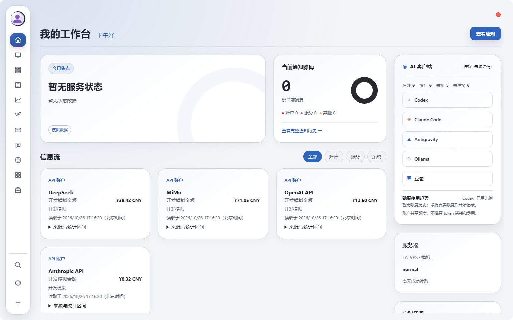
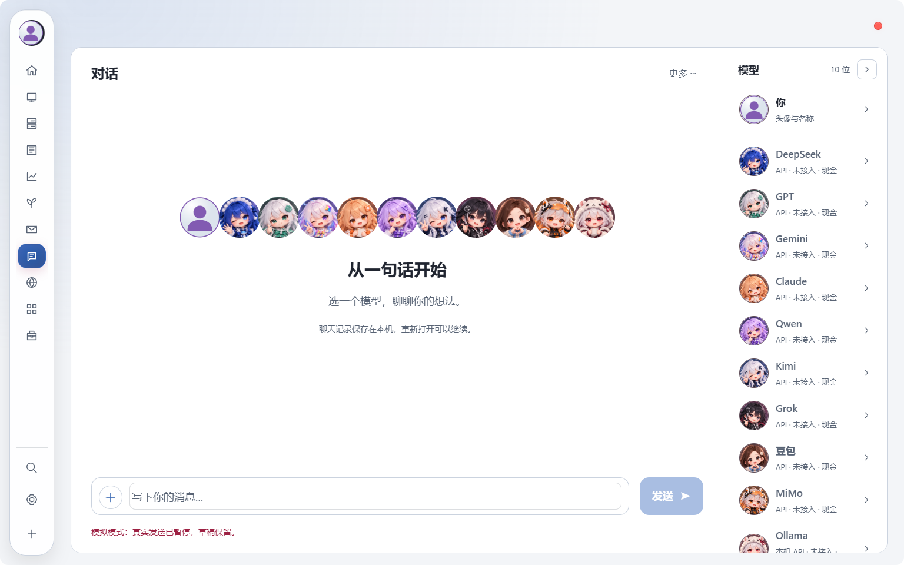
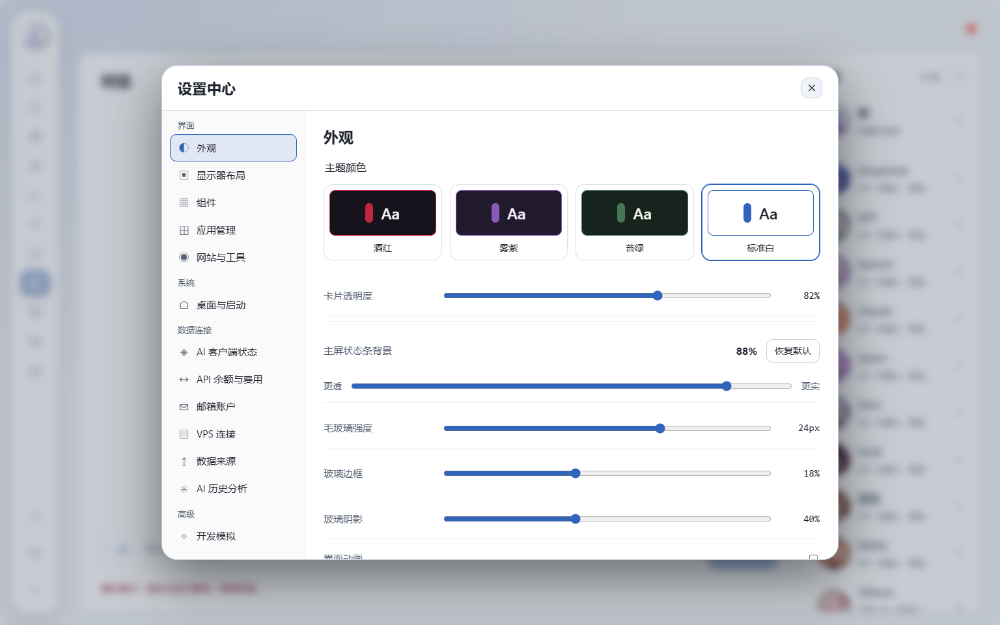

<div align="center">

# GleamDesk

**栖光桌面 — A little light for your desktop.**

A Windows workspace for HUD, Dock, system status, public data and Agent Room.

[简体中文](README.zh-CN.md) · [User guide](docs/USAGE.md) · [Build](docs/BUILDING.md) · [Report an issue](https://github.com/liuyuanlong3232-bit/GleamDesk/issues)


</div>



> Clean browser-preview screenshots. The overview uses explicitly labeled built-in simulation values. No personal accounts, server connections, model calls or private chats are used. These previews do not demonstrate native Windows behavior or live data connectivity.

## Features

| Area | What it provides |
| --- | --- |
| Desktop surfaces | Persistent HUD and Dock, an on-demand workbench, and whole-app exit from HUD |
| System resources | Native Windows CPU, memory, disk, network and event status |
| Public data | Direct news, market and agricultural sources with provenance, dates and units |
| Watchlist | Add A-shares, US stocks, Hong Kong stocks and supported futures codes |
| Agent Room | Model members, conversations and rooms using your own configured providers |
| Personalization | Themes, layouts, display name and local avatar selection |
| Optional services | User-configured Beszel, 3x-ui, sing-box and Tailscale readers |

**No author-hosted VPS is required.** New installations contain no author account, personal watchlist, server configuration or credentials. Free sources can be managed in settings; SSH, optional service connections and automatic paid generation start disabled.

## Get started

This is an early **source release**, version `0.1.0`. No signed installer or prebuilt release download has been published yet.

Build requirements: Windows 10/11, Node.js 22+, Rust stable, Visual Studio C++ Build Tools, Windows SDK and WebView2 Runtime. Native integrations target Windows; macOS and Linux releases are not provided or verified.

```powershell
git clone https://github.com/liuyuanlong3232-bit/GleamDesk.git
cd GleamDesk
npm.cmd ci
npm.cmd run tauri -- dev
```

See [Build from source](docs/BUILDING.md) for validation and executable build commands. See the [user guide](docs/USAGE.md) for startup, watchlists and optional connections.

## Screenshots

### Agent Room



### Appearance settings



[Capture details](docs/images/README.md). The default public avatar is generic; users can choose their own image locally.

## Data and privacy

Public sources may be delayed, rate-limited, changed or inaccessible on some networks. Free access does not guarantee availability without a proxy. Missing or stale values remain identified; collection time is not substituted for source time, and contract relationships are not guessed.

Settings, avatars and history stay on the running computer. Supported secrets use Windows Credential Manager. Optional AI, mail, SSH and service connections use your own accounts. This project does not provide financial advice or third-party data redistribution rights.

Read [data sources](docs/open-source-data-connections.md), [privacy](docs/PRIVACY.md) and [optional services](docs/vps-services.md).

## Documentation and community

- [Build](docs/BUILDING.md) and [architecture](docs/ARCHITECTURE.md)
- [Contributing](CONTRIBUTING.md) and [code of conduct](CODE_OF_CONDUCT.md)
- [Security reporting](SECURITY.md), [changelog](CHANGELOG.md) and [acknowledgments](ACKNOWLEDGMENTS.md)
- [Bug reports and feature requests](https://github.com/liuyuanlong3232-bit/GleamDesk/issues)

Developed with assistance from OpenAI Codex. This is an independent project, not an official OpenAI product.

## License

Original project contributions are [MIT licensed](LICENSE). Third-party code and assets retain their own notices, including [vendored wry](vendor/wry), [HUD sources](docs/licenses/agent-hud-THIRD-PARTY-NOTICES.txt) and [service adapters](licenses/vps-services/README.md). Names, logos, data and services belong to their respective owners.
