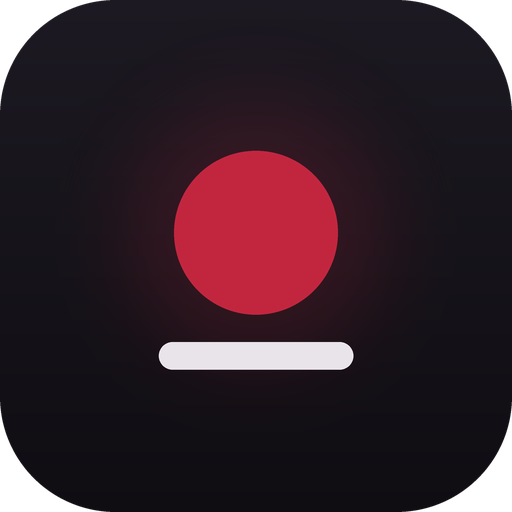
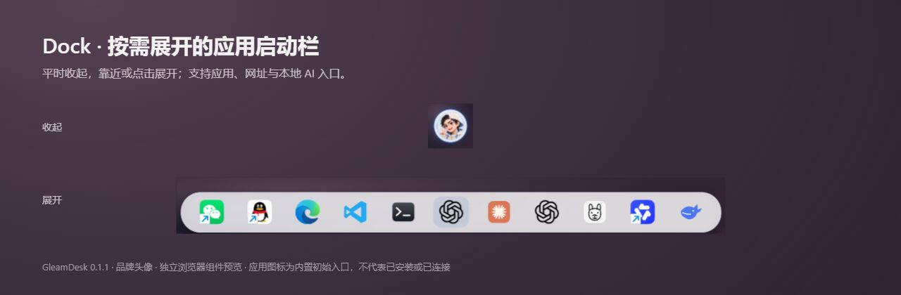
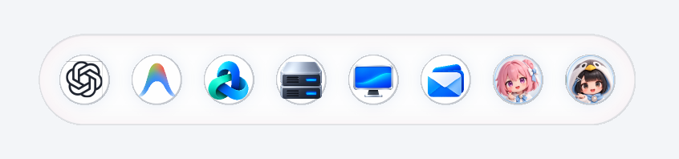
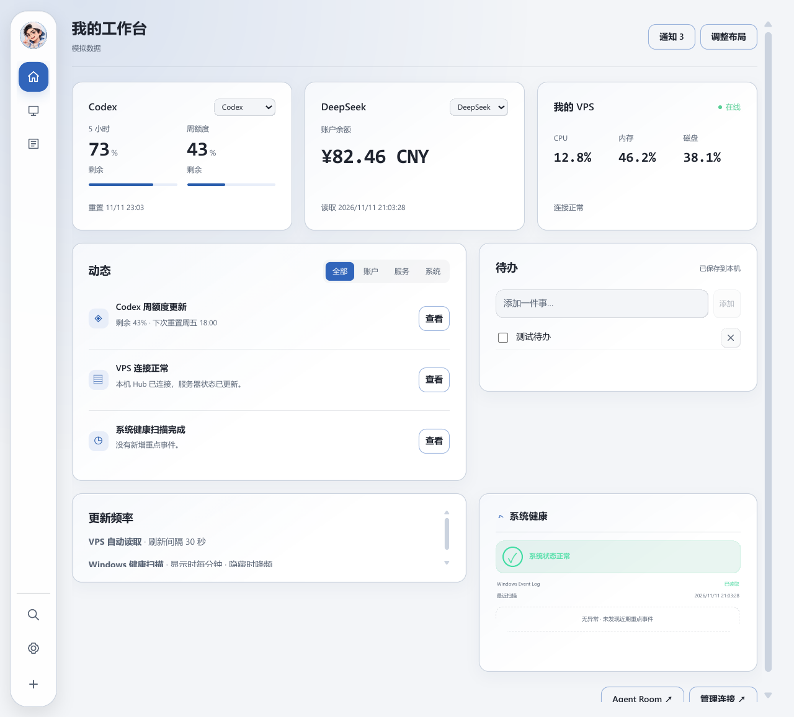
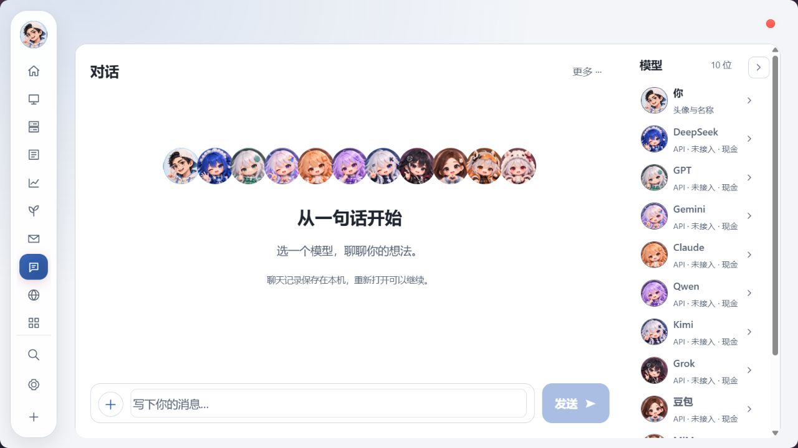
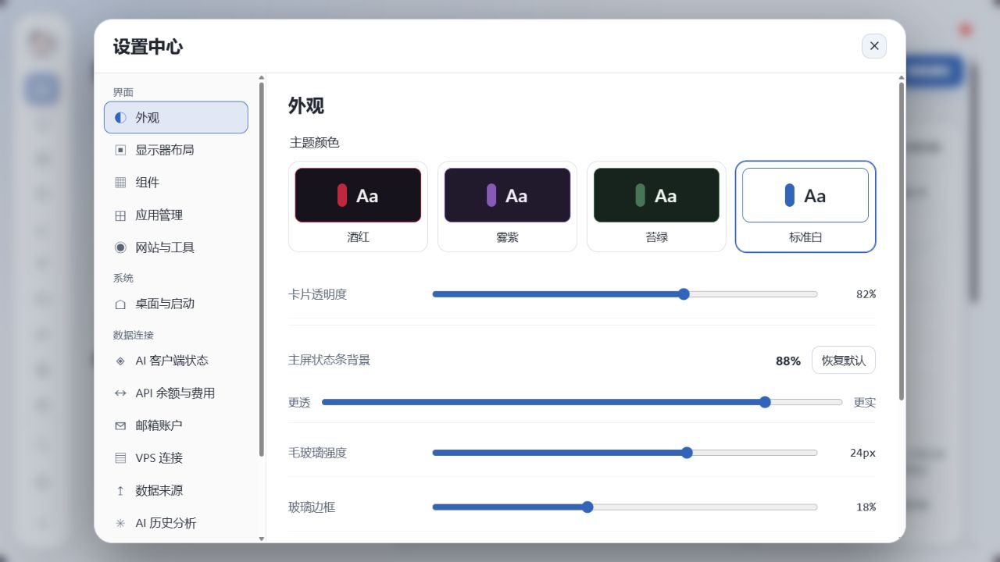

<div align="center">



# GleamDesk

**栖光桌面 — A little light for your desktop.**

A personal Windows desktop companion: a compact HUD and Dock, with a customizable workbench for AI quotas, API accounts, email codes and everyday information.

[简体中文](README.zh-CN.md) · [Download for Windows](https://github.com/liuyuanlong3232-bit/GleamDesk/releases/tag/v0.1.10) · [User guide](docs/USAGE.md) · [Build](docs/BUILDING.md) · [Report an issue](https://github.com/liuyuanlong3232-bit/GleamDesk/issues)


</div>

## Why GleamDesk

Keep frequently checked status and everyday shortcuts on your desktop. Open the full workbench when you need it.

- **Start small:** startup shows only the Dock and HUD by default.
- **Check status at a glance:** supported AI-client quotas, API accounts, local PC and optional VPS status share one HUD. Coverage varies by source; unavailable values remain unknown.
- **Catch what matters:** optional email reminders and verification-code copying, plus daily GitHub, Skills, Hugging Face Spaces and Show HN recommendations with offline translation.
- **Choose your shortcuts:** add apps, URLs and local AI entries, reorder them by dragging and choose your own icons.
- **Arrange your workbench:** drag and resize overview cards, keep your to-dos nearby, and restore your layout next time. Cards reveal available data with restrained motion.
- **Match your desktop:** burgundy, lavender, moss and white themes, rounded glass surfaces and matching API, mail, PC and VPS icons.
- **Connect directly:** public news, market and agricultural sources run from your own computer, with optional custom HTTP quote mappings.

### Dock — compact until you need it



Hover over or click the avatar to expand the launcher; move away to collapse it. Add your own applications and URLs, or open the workbench from the avatar. New installations start without placeholder applications. Change the display name and avatar at the top left of the workbench.

### HUD — persistent status with expandable details



Compact icons and status rings keep the desktop clear. Click to pin details, drag the icon bar to dock on any screen edge, and use the workbench avatar to open the main or secondary display. API, mail, PC and VPS icons follow the selected theme. **Exit the whole app from the HUD context menu**; closing the workbench only hides it.

> These are isolated browser previews of the actual React components. Overview values are simulation data; the older Dock preview shows starter entries. Avatars are creator-authorized public brand artwork. No personal accounts, servers or chats were read. Previews do not prove live quotas, connectivity or native Windows window behavior. [Capture details](docs/images/README.md).

## Features

| Area | What it provides |
| --- | --- |
| Desktop surfaces | Persistent HUD and Dock, an on-demand workbench, and whole-app exit from HUD |
| Workbench overview | Seven draggable, resizable cards with saved layout, to-dos and data arrival animations |
| Email reminders | Optional read-only message summaries and verification-code copying; open webmail by clicking a message |
| Daily discoveries | GitHub, Skills, Hugging Face Spaces and Show HN with local offline translation |
| System resources | Native Windows CPU, memory, disk, network and event status |
| Public data | Direct news, market and agricultural sources with provenance, dates and units |
| Watchlist | Add A-shares, US stocks, Hong Kong stocks and supported futures codes |
| Agent Room | Model members, conversations and rooms using your own configured providers |
| Personalization | Themes, layouts, display name and local avatar selection |
| Optional services | User-configured Beszel, 3x-ui, sing-box and Tailscale readers |

**No author-hosted VPS is required.** New installations contain no author account, personal watchlist, server configuration or credentials. Free sources can be managed in settings; SSH, optional service connections and automatic paid generation start disabled.

## Get started

Version 0.1.10 restores expired MiMo balance sessions using its own official login window, isolates each Agent’s account and quota refresh, and adds a separate Doubao connection that works while its client is running. The desktop Dock stays below other applications and its context menu closes on outside clicks. QQ and 163 mail were connected locally; Gmail and Outlook real-account flows remain unverified. Versions 0.1.2 and earlier need one manual installation first.

Download the Windows x64 packages from [GitHub Release v0.1.10](https://github.com/liuyuanlong3232-bit/GleamDesk/releases/tag/v0.1.10):

| File | Use |
| --- | --- |
| `GleamDesk_0.1.10_x64-setup.exe` | Installer for the current Windows user |
| `GleamDesk_0.1.10_windows_x64_portable.zip` | Extract and run `GleamDesk.exe` without app installation |
| `SHA256SUMS.txt` | SHA-256 checksums for downloaded files |
| `GleamDesk-icon.png` | The approved GleamDesk mascot application icon |

**0.1.10 has no Windows publisher signature.** Update signatures verify future in-app upgrades and do not replace a Windows publisher certificate. Windows may show an unknown-publisher warning. Checksums verify file integrity and do not replace publisher signatures. Both packages require WebView2 Runtime; setup downloads Microsoft's runtime installer if missing. Portable means installation-free: settings and history still use local AppData, rather than a self-contained profile beside the executable. Read [Windows package notes](docs/WINDOWS_PACKAGES.md).

Build requirements: Windows 10/11, Node.js 22+, Rust stable, Visual Studio C++ Build Tools, Windows SDK and WebView2 Runtime. Native integrations target Windows; macOS and Linux releases are not provided or verified.

```powershell
git clone https://github.com/liuyuanlong3232-bit/GleamDesk.git
cd GleamDesk
npm.cmd ci
npm.cmd run tauri -- dev
```

See [Build from source](docs/BUILDING.md) for validation and executable build commands. See the [user guide](docs/USAGE.md) for startup, watchlists and optional connections.

## Screenshots

### On-demand workbench



Overview balances are explicitly labeled simulation values, not real accounts or investment results.

### Agent Room



### Appearance settings



[Capture details](docs/images/README.md). The default avatar is the creator-authorized GleamDesk brand logo; users can replace it locally.

## Data and privacy

Public sources may be delayed, rate-limited, changed or inaccessible on some networks. Free access does not guarantee availability without a proxy. Missing or stale values remain identified; collection time is not substituted for source time, and contract relationships are not guessed.

Settings, avatars and history stay on the running computer. Supported secrets use Windows Credential Manager. Optional AI, mail, SSH and service connections use your own accounts. This project does not provide financial advice or third-party data redistribution rights.

Read [data sources](docs/open-source-data-connections.md), [privacy](docs/PRIVACY.md), [data and asset rights](docs/DATA_AND_ASSET_RIGHTS.md) and [optional services](docs/vps-services.md). Local AI account/usage reads require opt-in in Settings → AI connections; ordinary running-app detection remains available. Public endpoints are not blanket redistribution licenses; unresolved permissions are listed in the rights record.

Settings → Version and updates supports manual checks and an optional startup check. In-app installation requires explicit confirmation and version-bound updater signatures; portable builds use manual downloads. Older releases need one manual installation of a build containing the updater. See [updates](docs/UPDATES.md) for publishing prerequisites and current limits.

## Documentation and community

- [Build](docs/BUILDING.md) and [architecture](docs/ARCHITECTURE.md)
- [Contributing](CONTRIBUTING.md) and [code of conduct](CODE_OF_CONDUCT.md)
- [Security reporting](SECURITY.md), [changelog](CHANGELOG.md) and [acknowledgments](ACKNOWLEDGMENTS.md)
- [Bug reports and feature requests](https://github.com/liuyuanlong3232-bit/GleamDesk/issues)

Developed with assistance from OpenAI Codex. This is an independent project, not an official OpenAI product.

## Contributors

| Contributor | Role |
| --- | --- |
| [liuyuanlong3232-bit](https://github.com/liuyuanlong3232-bit) | Project author and maintainer; product decisions, review and releases |
| OpenAI Codex | AI assistance with implementation, testing and documentation |

This section describes project roles. GitHub's automatically generated contributor statistics are based on commit attribution and may differ.

## License

Original project contributions are [MIT licensed](LICENSE). Third-party code and assets retain their own notices, including [vendored wry](vendor/wry), [HUD sources](docs/licenses/agent-hud-THIRD-PARTY-NOTICES.txt) and [service adapters](licenses/vps-services/README.md). Names, logos, data and services belong to their respective owners.

## Code signing policy

Windows packages are currently unsigned. The [code signing policy and application readiness](docs/CODE_SIGNING.md) describe the proposed process; SignPath Foundation approval and trusted-publisher signing are not yet in place.
