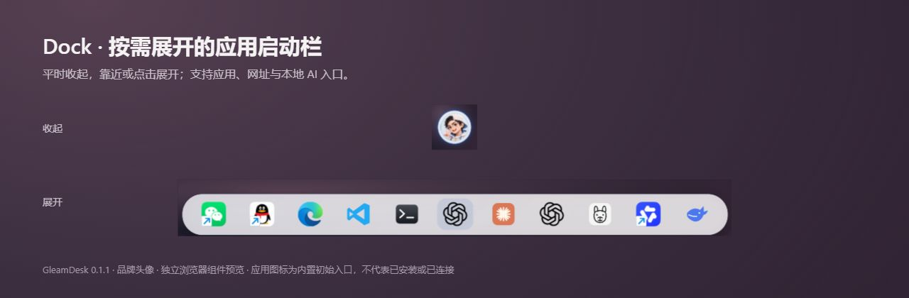
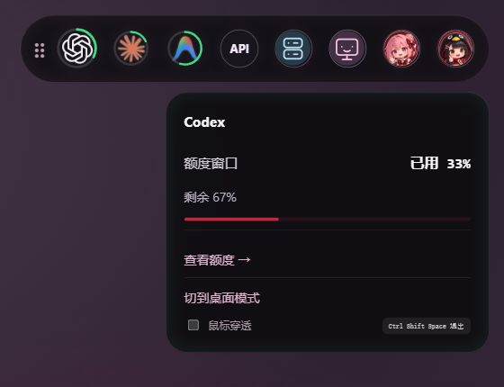
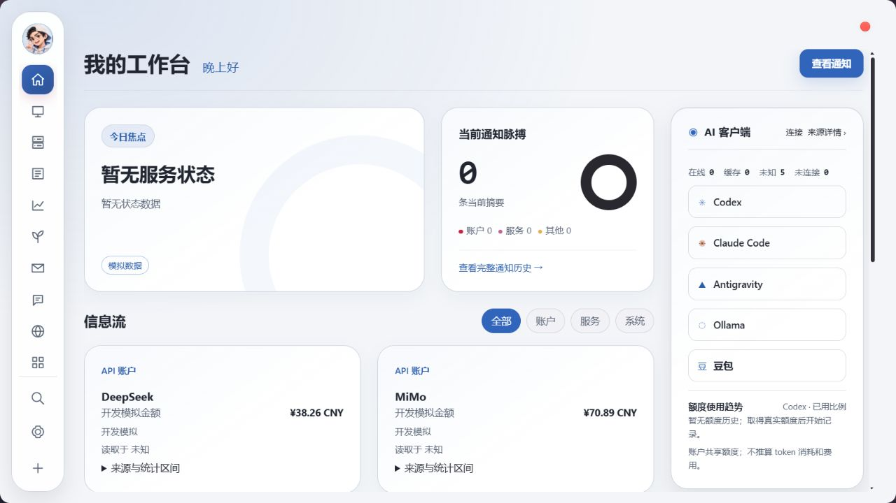
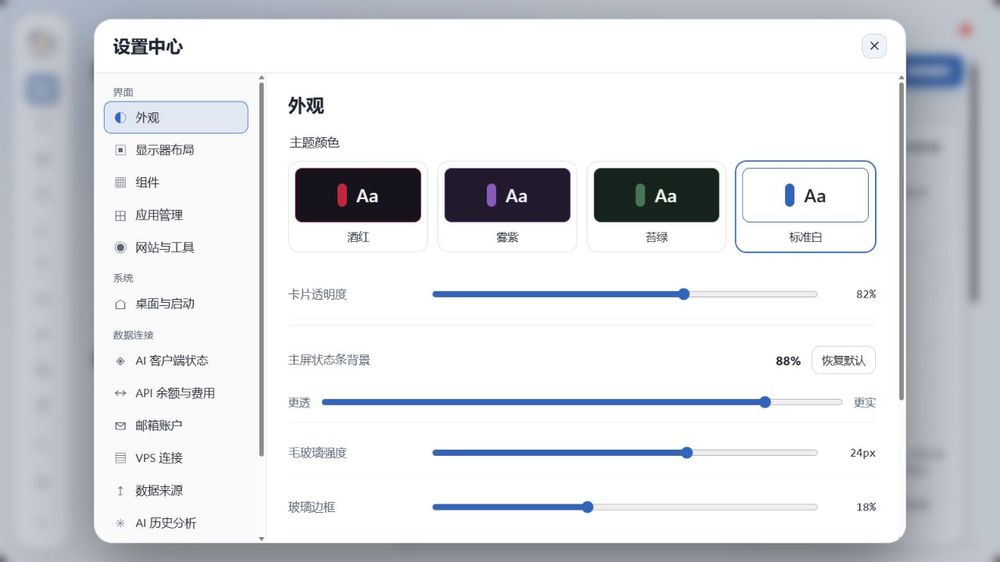

# 栖光桌面 · GleamDesk

**让状态常驻，让工作更轻。**

[English](README.md) · [Windows 下载](https://github.com/liuyuanlong3232-bit/GleamDesk/releases/tag/v0.1.0) · [使用指南](docs/USAGE.md) · [编译说明](docs/BUILDING.md) · [问题反馈](https://github.com/liuyuanlong3232-bit/GleamDesk/issues)

基于 Tauri、React、TypeScript 和 Rust 的 Windows 桌面工作台，将顶部 HUD、Dock、系统资源、公开数据和 Agent Room 放在一起。

## 为什么做栖光桌面

把常看的状态与常用入口留在桌面，需要时再展开完整工作台。

- **启动不占满屏幕**：默认只显示 Dock 和顶部 HUD，工作台按需打开。
- **状态随手看**：HUD 汇集受支持的 AI 客户端额度、API 账户、系统与可选服务器状态，悬停或点击查看详情。各来源支持程度不同，未获取到的数据会标记未知。
- **入口自己安排**：Dock 支持应用、网址与本地 AI 入口；拖入添加、拖动排序，并可修改图标。
- **桌面风格统一**：酒红、雾紫、苔绿、标准白四种主题，搭配圆角玻璃面板与可调整布局。
- **电脑直连数据**：新闻、市场与农业公开数据不依赖作者服务器，可再添加自己的 HTTP 行情接口。

### Dock：收起时是头像，展开后是启动栏



靠近或点击头像展开；离开后自动收起。可以固定常用应用和网址；内置图标只是初始入口，首次使用仍需配置本机应用路径。点击头像可打开工作台，显示名字和头像可在工作台左上角修改。

### 顶部 HUD：常驻状态，按需展开



圆形图标和状态环减少桌面占用，点击可固定详情。拖动 HUD 可贴到屏幕四边；企鹅按钮打开工作台，并可选择主屏或副屏。**退出整个软件在 HUD 右键菜单中**；关闭工作台只隐藏工作台。

> 以上为真实 React 组件的独立浏览器预览，HUD 数值是开发模拟数据，Dock 使用创作者授权公开的品牌头像及内置入口。未读取私人账户、服务器或聊天。预览不代表真实额度、已安装应用或连接成功；窗口穿透、跨屏与系统启动行为以 Windows 桌面版为准。[截图说明](docs/images/README.md)

## 功能

| 模块 | 能做什么 |
| --- | --- |
| HUD 与 Dock | 常驻状态、应用入口、按需展开工作台、HUD 退出整个程序 |
| 系统资源 | Windows 本机 CPU、内存、磁盘、网络与事件状态 |
| 新闻、市场与农业 | 电脑直连公开来源；保留来源、日期、单位与缺失状态 |
| 自选 | 添加 A股、美股、港股及受支持的期货代码 |
| Agent Room | 模型成员与房间界面，按需配置自己的模型连接 |
| 个性化 | 主题、布局、显示名字与本机头像 |
| 可选服务 | Beszel、3x-ui、sing-box、Tailscale；用户自行配置 |

**不依赖作者 VPS。** 新安装没有作者账户、服务器配置、个人自选和凭据。免费数据来源默认启用；SSH、可选服务和自动付费生成默认关闭。

## 开始使用

当前源码与截图为 0.1.1 候选；下方下载入口仍是已发布的 0.1.0，待新版发布后更新。

从 [GitHub Release v0.1.0](https://github.com/liuyuanlong3232-bit/GleamDesk/releases/tag/v0.1.0) 下载 Windows x64 版本：

| 文件 | 使用方式 |
| --- | --- |
| `GleamDesk_0.1.0_x64-setup.exe` | 安装版，仅为当前用户安装 |
| `GleamDesk_0.1.0_windows_x64_portable.zip` | 免安装版，解压后运行 `GleamDesk.exe` |
| `SHA256SUMS.txt` | 下载文件的 SHA-256 校验值 |

**0.1.0 是早期版本，尚未数字签名**，Windows 可能提示“未知发布者”。SHA-256 用于核对文件完整性，不能替代发布者签名。两种版本均需要 WebView2 Runtime；安装版在缺失时下载官方运行库。免安装版仍将个人设置和历史保存在本机 AppData，不是随文件夹携带的独立配置。详见 [Windows 安装说明](docs/WINDOWS_PACKAGES.md)。

需要自行编译时，准备 Windows、Node.js 22、Rust stable、Visual Studio C++ 构建工具和 WebView2 Runtime：

```powershell
git clone https://github.com/liuyuanlong3232-bit/GleamDesk.git
cd GleamDesk
npm.cmd ci
npm.cmd run tauri -- dev
```

详细命令与构建输出见 [编译说明](docs/BUILDING.md)。本项目以 Windows 为目标；未提供或验证 macOS/Linux 发行版本。

## 更多截图

### 按需打开的工作台



首页金额为标明的开发模拟数据，不代表实际账户或投资收益。

### Agent Room


### 外观设置



## 数据与隐私

- 公共来源可能延迟、限流、改变接口或在部分网络无法访问。免费不等于全部地区无需代理。
- 保留实际来源日期、币种和单位；不把读取时间当成行情时间，不推测缺失价格或主力关系。
- 用户配置、头像和历史保存在本机；支持的凭据通过 Windows 凭据管理器保存。模型、邮箱和服务连接使用用户自己的账户。
- 本项目不提供投资建议。第三方数据、商标和服务权利不由项目许可证授予。

详见 [数据来源](docs/open-source-data-connections.md)与[隐私说明](docs/PRIVACY.md)。

## 文档与参与

[使用指南](docs/USAGE.md) · [架构](docs/ARCHITECTURE.md) · [贡献指南](CONTRIBUTING.md) · [行为准则](CODE_OF_CONDUCT.md) · [安全反馈](SECURITY.md) · [变更记录](CHANGELOG.md) · [致谢](ACKNOWLEDGMENTS.md)

原创代码采用 [MIT](LICENSE)。第三方代码与素材保留各自许可证。使用 OpenAI Codex 辅助开发，不代表 OpenAI 官方项目或背书。

## 贡献者

| 贡献者 | 角色 |
| --- | --- |
| [liuyuanlong3232-bit](https://github.com/liuyuanlong3232-bit) | 项目作者与维护者，负责产品决策、审核和发布 |
| OpenAI Codex | AI 开发协助，参与实现、测试和文档整理 |

此处说明项目角色；GitHub 自动统计的贡献者列表基于提交署名，可能与本表不同。

## Code signing policy / 数字签名

Windows 安装包目前仍未签名。[签名政策与申请准备情况](docs/CODE_SIGNING.md)列出了计划中的构建、人工审批和发布流程；尚未获得 SignPath Foundation 批准，也未配置签名凭据。
